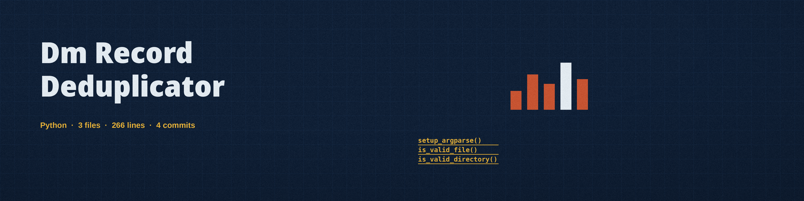

# dm-record-deduplicator
Identifies and removes duplicate records based on a configurable set of columns. Can be used to obfuscate the true size of a dataset. CLI tool with options for specifying key columns, and methods for handling near-duplicate records with a user-defined similarity threshold. - Focused on Tools designed to generate or mask sensitive data with realistic-looking but meaningless values

## Install
`git clone https://github.com/ShadowStrikeHQ/dm-record-deduplicator`

## Usage
`./dm-record-deduplicator [params]`

## Parameters
- `-h`: Show help message and exit
- `-k`: List of column names to use for identifying duplicates.
- `-t`: Similarity threshold for near-duplicate detection (0.0 to 1.0). Similarity is the difflib ratio, an edit based measure, averaged over the key columns.
- `-n`: Enable near-duplicate detection based on similarity threshold. Rows are compared across all rows regardless of the first key column, and input row order is preserved in the output.
- `-l`: Path to the log file.

## License
Copyright (c) ShadowStrikeHQ

The output file must not be the same file as the input file, and the log file must not be the same file as the input file. A run that names the same file for any of those is refused and nothing is written.
Near duplicate mode compares each row against the rows kept so far across the whole file, not only within groups that share the first key column. Similarity between two text values is the difflib ratio, an edit based measure, averaged over the key columns. The output keeps rows in their input order.
